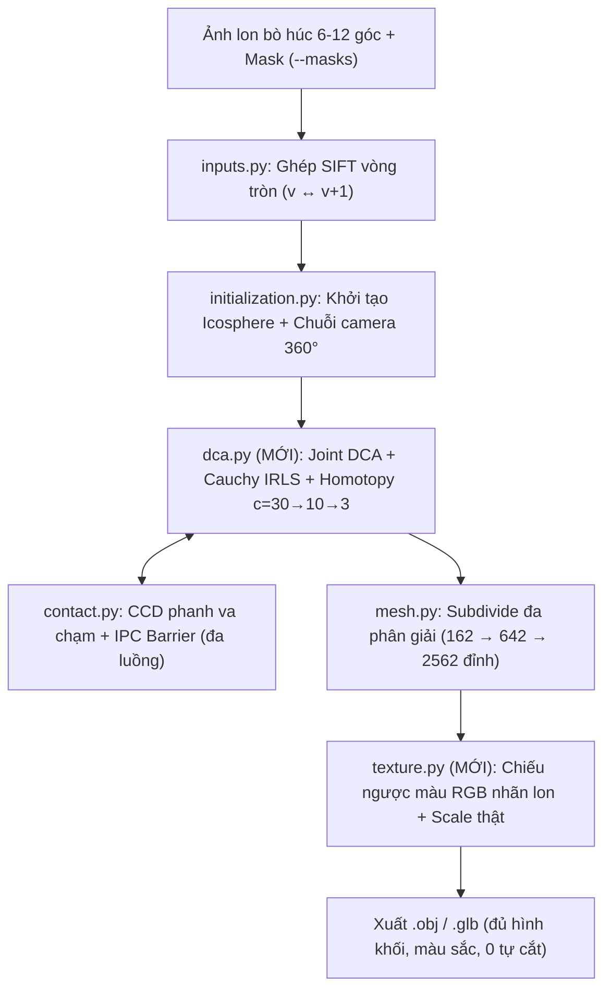

# Kế hoạch Nâng cấp Thuật toán DCA & Xây dựng Bản đồ 3D Lon Bò Húc

- **Trạng thái:** Đã chốt kế hoạch (chờ triển khai thực thi từ Pha 0).
- **Thư mục mã nguồn hiện tại:** `c:\doan\reconstruction_generic_code_20261114 (1)` *(khuyến nghị đổi tên thành `c:\doan\reconstruction_dca_3d` ở Pha 0)*.
- **Tài liệu thuật toán tham chiếu:** Bài báo của thầy hướng dẫn (*Single-view recovery of road geometry: a family of projections uniform in the inverse viewing distance, its orthographic limit, and a nonconvex variational problem*, 25/10/2026 — Mục 11 & Phụ lục B).

---

## 1. Mục tiêu & Kiến trúc tổng thể

Kết hợp **thuật toán DCA trong Mục 11 bài báo PDF** (Cauchy robust loss + trọng số IRLS $w_i$ + phân cực cục bộ trên $SO(3)$ + Homotopy $c$ + tối ưu đồng thời) vào **khung tái dựng lưới 3D đa góc nhìn chống tự cắt (IPC/CCD)** trong `c:\doan`, đồng thời mở rộng để dựng bản đồ 3D hoàn chỉnh cho **lon bò húc**.

---

## 2. Chi tiết 5 Pha triển khai

### Pha 0 — Dựng môi trường & Chạy chuẩn đối chứng (Baseline)
1. Chuẩn hóa tên thư mục gốc (bỏ dấu cách & `" (1)"` $\rightarrow$ `reconstruction_dca_3d`).
2. Tạo `.venv` Python **3.12.13** bằng `uv` và cài các thư viện trong `code/requirements-reconstruction.txt` (`numpy==2.5.4`, `scipy==1.18.1`, `Pillow==13.0.0`, `matplotlib==3.11.2`, `opencv-python-headless==4.10.0.84`, `ipctk==1.6.1`, `libigl==2.6.3`).
3. Chạy bộ test có sẵn (`check_point_uncertainty.py`, `check_smooth_fields.py`, `check_contact.py`, `check_contact_integration.py`, `check_hidden_completion.py`) và chạy mẫu `reconstruct_images.py` trên `raw_inputs/view_01.webp`, `view_02.webp` để lấy bộ số liệu Baseline của bản Adam-Armijo.

### Pha 1 — Tích hợp Thuật toán DCA thật từ Mục 11 bài báo PDF
1. **Cauchy Robust Loss & IRLS Weights (`point_terms.py`, `losses.py`, `engine.py`):**
   - Dùng hàm mất mát Cauchy:
     $$F_{\text{cauchy}}(r; c) = \frac{1}{2} c^2 \log\left(1 + \frac{r^2}{c^2}\right), \quad w_i = \frac{1}{1 + (r_i/\sigma)^2 / c^2}$$
   - Mục đích: Tự động hạ trọng số các cặp điểm SIFT nhiễu giả do phản chiếu kim loại trên vỏ lon bò húc.
2. **Bộ giải Joint DCA mới (`code/reconstruction/dca.py`):**
   - **Tuyệt đối tối ưu đồng thời (Joint DCA)** cả đỉnh lưới `X` và camera `C, g, lf, pp` (vì bài báo PDF đã chứng minh Block-cyclic DCA thất bại `0/40`).
   - Giữ phép cập nhật xoay trên bản đồ chuẩn đại số Lie $g \leftarrow \exp([\omega]_\times) g$.
   - Giải bài toán con lồi có trọng số (Phương trình 34 PDF) bằng **CG / L-BFGS-B nội bộ** trên tích Jacobian-vector (không tạo ma trận Hessian dày đặc để tiết kiệm RAM).
   - Giữ chốt chặn CCD `contact_model.safe_fraction(X, X + d_X)` và `valid()`.
   - Áp dụng điều kiện giảm đủ $F(\Theta_k \oplus d) \le F(\Theta_k) - 10^{-4}\mu \|d\|_D^2$ và quy tắc thích nghi $\mu$: từ chối $\rightarrow \mu \leftarrow 4\mu$; chấp nhận $\rightarrow \mu \leftarrow \mu / 3$.
   - Chạy Homotopy (Graduated Non-Convexity) giảm dần thang đo $c = 30 \to 10 \to 3$.
3. **Thí nghiệm đối chứng (`code/run_dca_study.py`):**
   - So sánh `Adam-Armijo` (`optimizer.py`) vs `L-BFGS-B` (`lbfgs.py`) vs `Joint DCA` (`dca.py`) trên cùng hàm mục tiêu và cùng dữ liệu (kể cả khi thêm 20–30% nhiễu giả).

### Pha 2 — Hỗ trợ Chụp Đa Góc 360° cho Lon Bò Húc (Xóa vùng khuất)
1. **Sửa `feature_pairs` (`code/reconstruction/inputs.py`):** Chuyển từ ghép hình sao (`view 0 ↔ view v`) sang ghép vòng tròn các cặp liền kề (`0↔1, 1↔2, ..., K-1↔0`).
2. **Sửa `initialize` (`code/reconstruction/initialization.py`):** Truyền hệ tọa độ camera nối tiếp theo vòng tròn qua các điểm chung liền kề.
3. **Quy trình chụp dữ liệu lon bò húc:** Chụp 8–12 ảnh xoay đều 360° quanh lon (góc nghiêng xuống 20–30° để thấy mặt nắp), dùng ánh sáng tản để hạn chế lóa vỏ nhôm, nền trơn hoặc cấp `--masks`.

### Pha 3 — Tăng độ mịn lưới & Tối ưu Bộ nhớ / Tốc độ
1. **Đa phân giải (Coarse-to-Fine) trong `code/reconstruct_images.py`:**
   - Giai đoạn 1: 42 → 162 đỉnh (khớp dáng trụ & camera).
   - Giai đoạn 2: `subdivide` lên **642 đỉnh / 1.280 tam giác**.
   - Giai đoạn 3 (xuất bản cuối): `subdivide` lên **2.562 đỉnh / 5.120 tam giác**, tinh chỉnh trọng số `smooth_weight` để giữ cạnh gờ sắc ở nắp và đáy lon.
2. **Tối ưu RAM & CPU:**
   - Trong `contact.py:20`: mở rộng `ipctk.set_num_threads(...)` từ `1` lên đa luồng CPU.
   - Trong `losses.py` (`silhouette_terms`): thay phép broadcast toàn phần `K × M × T` bằng lọc hộp bao 2D (AABB) trước khi tính khoảng cách cạnh gần nhất.
   - Trong `engine.py` (`arrays`): tăng mật độ mẫu `targets` dọc viền mask (250–400 điểm ở `512px`).

### Pha 4 — Tạo "Bản đồ 3D" có Nhãn Màu & Kích thước thật
1. **Chiếu màu nhãn lon (`code/reconstruction/texture.py`):** Dùng camera tối ưu + kiểm tra tầm nhìn `first-hit` để chọn góc ảnh trực diện nhất cho từng mặt tam giác, bake màu RGB thành file `texture.png` + UV map, cập nhật `export_mesh()` (`geometry.py`) xuất `.obj`/`.mtl`/`.glb` có màu đầy đủ.
2. **Chuẩn hóa kích thước thật:** Thêm tham số `--reference-height-mm` (ví dụ `134.0` mm) để đưa tọa độ lưới về đúng đơn vị milimet.

---

## 3. Đánh giá Phần cứng & Ngân sách RAM trên Máy Hiện tại

- **Cấu hình máy đã kiểm tra:** Windows 11 Home 64-bit · CPU `AMD Ryzen 5 7640HS` (6 nhân / 12 luồng) · RAM `15.29 GB` · GPU `NVIDIA GeForce RTX 3050 6GB Laptop` · Ổ `C:` trống `93.4 GB` · Đã có `uv` & Python `3.12.13`.

| Kịch bản chạy | Cấu hình dữ liệu | Peak RAM *(ước tính)* | RAM trống cần trước khi chạy |
| :--- | :--- | :--- | :--- |
| **Thử nghiệm (Pha 0 – Pha 1)** | 2 ảnh `384×384`, 162 đỉnh | **~0.5 – 1.2 GB** | **Tối thiểu 2.0 GB** |
| **Đầy đủ (Pha 2 – Pha 4, đã lọc AABB ở `losses.py`)** | 8–12 ảnh `512×512`, 642–2.562 đỉnh + Texture | **~1.5 – 2.8 GB** | **Khuyến nghị 3.5 – 4.5 GB** |
| **Nếu chưa tối ưu `losses.py`** | 12 ảnh, 2.562 đỉnh, 2.000 mẫu/mask | **~7.0 – 9.0 GB** | **9.0 – 10.0 GB** *(tránh bằng Pha 3)* |

---

## 4. Tiêu chí Nghiệm thu
1. Bộ test `check_*.py` gốc chạy qua 100%; `Joint DCA` hội tụ tốt hơn hoặc ngang `Adam-Armijo` khi có 20–30% điểm SIFT nhiễu giả.
2. `libigl` báo `0` cặp tam giác tự cắt ở mọi bước.
3. Toàn bộ 8–12 góc chụp lon bò húc đạt Mask IoU $\ge 97\%$, không còn vết lồi lõm ở mặt sau, hiển thị rõ nhãn màu trên `.glb`/`.obj`.
4. Peak RAM thực tế không vượt quá **3 GB** ở cấu hình khuyến nghị.
