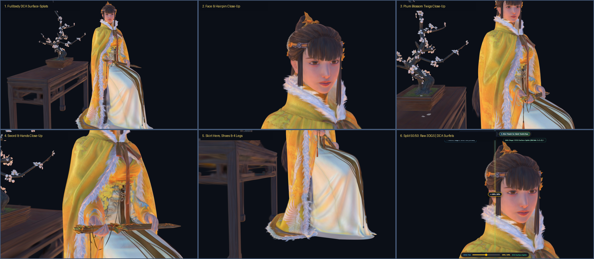
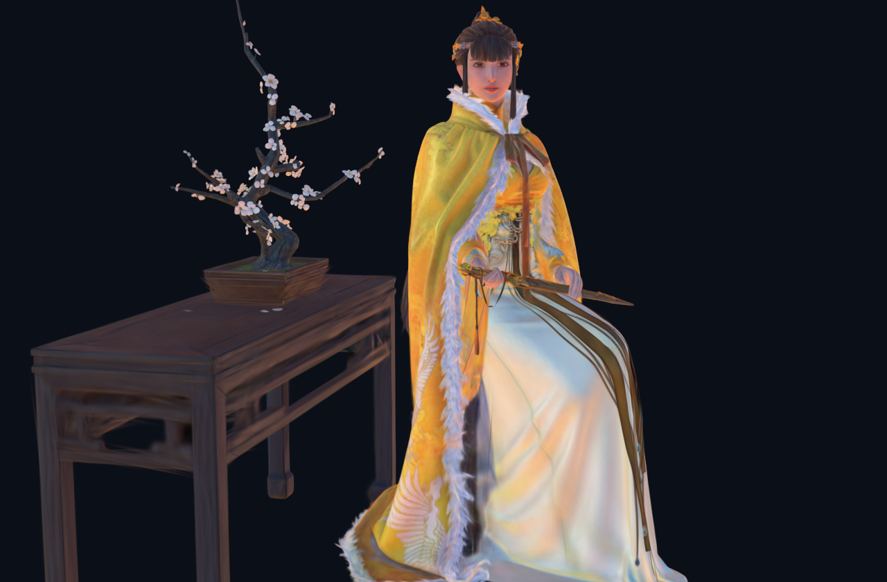
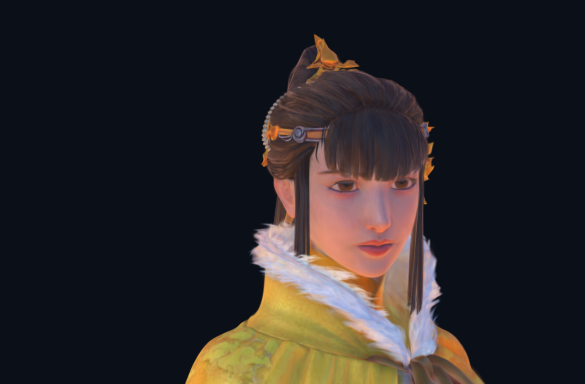
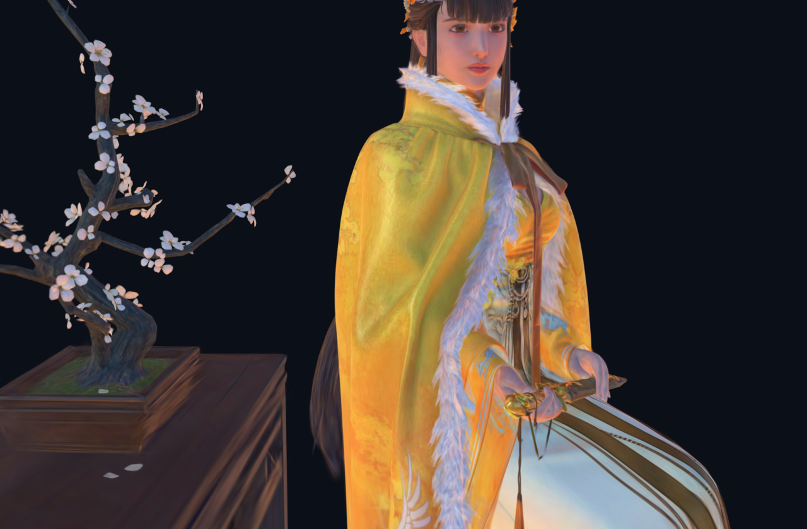
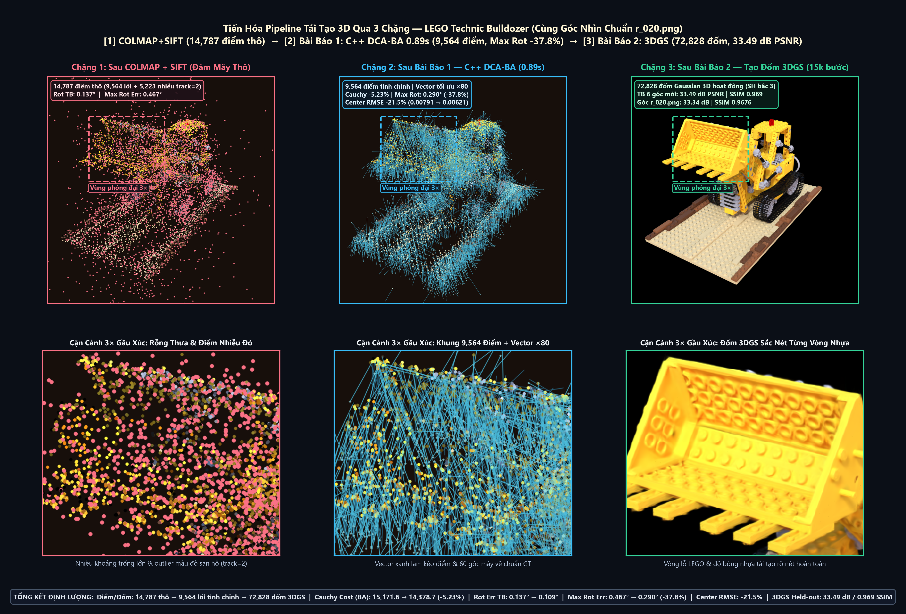
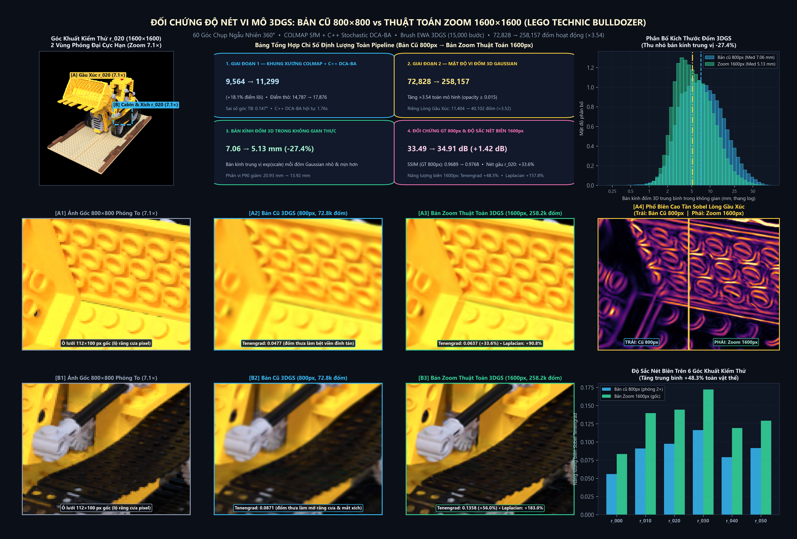
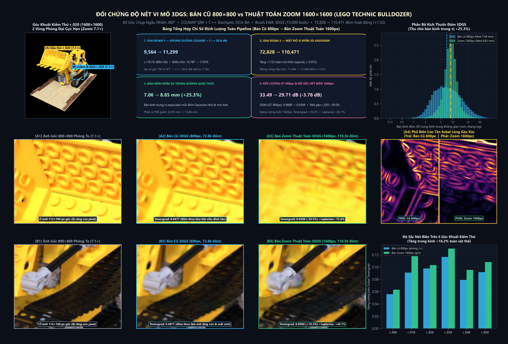
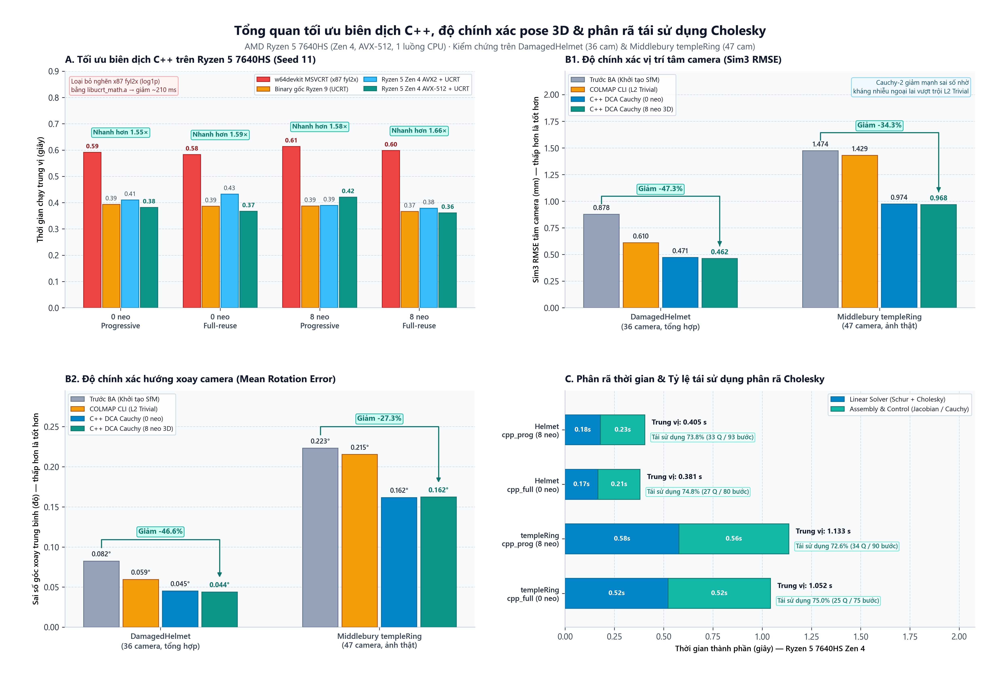

# DCA 3D Reconstruction — Multi-View SfM, Stochastic DCA Bundle Adjustment & 3D Gaussian Splatting

Hệ thống tái tạo mô hình 3D độ nét cao từ ảnh đa góc nhìn / đa cự ly sử dụng **Quy hoạch DC & Thuật toán DCA (Difference-of-Convex Algorithms)** kết hợp xuyên suốt từ khâu định vị khung camera thưa trên CPU tới tối ưu đốm **3D Gaussian Splatting (`3DGS` / `CUDA GPU-QP2` / `DCA Surface-Splats`)** trên GPU.

> **Lưu trữ nhánh nghiên cứu cũ:** Phiên bản thử nghiệm biến dạng lưới vòng 360° trước đây được lưu riêng tại nhánh [`archive/legacy-mesh-dca`](https://github.com/vietc3k49-design/dca-3d-reconstruction/tree/archive/legacy-mesh-dca). Nhánh `main` hiện tại tập trung trọn vẹn vào pipeline chuẩn hóa **Giai đoạn 0 $\rightarrow$ Giai đoạn 1 $\rightarrow$ Giai đoạn 2**.

---

## Hình Ảnh Kết Quả Nổi Bật

### 1. *Eastern Female Swordsman* — Tái Tạo Toàn Thân & Chi Tiết Vi Mô Từ Đúng 36 Ảnh Đa Cự Ly (`1536×1536` RGBA)


| Toàn thân (`144 FPS` WebGL 2.0) | Cận mặt & Trâm vàng (`1,372 px/m`) | Cận cành hoa mai `2–3 mm` (`1,398 px/m`) |
| :---: | :---: | :---: |
|  |  |  |

### 2. *LEGO Technic Bulldozer* — Ghép Mù 60 Góc, Mở Rộng Lưới `Zoom 2.0×` & Bộ Giải Gốc `CUDA GPU-QP2`


| Chứng minh Mở rộng lưới `800×800 → 1600×1600` (`+1.42 dB` PSNR) | Bộ giải gốc `CUDA C++ GPU-QP2` (`26`-biến Morton, nhanh gấp `3.0×`) |
| :---: | :---: |
|  |  |

---

## Kiến Trúc Pipeline (Giai Đoạn 0 $\rightarrow$ Giai Đoạn 2)

1. **Giai đoạn 0 — Thu Nhận Ảnh Đa Góc / Đa Cự Ly & Tách Nền Kép RGBA (`sketchfab_capture/`):**
   - Điều khiển tự động quỹ đạo camera cầu 360° hoặc đa tâm ngắm (toàn thân + cận mặt + cận chi tiết mảnh + góc nhìn cao), tắt toàn bộ nhãn chú thích/vignette và tách kênh `RGBA` chính xác tuyệt đối bằng cặp nền Đen/Trắng (`Dual-Background Alpha Matting`).
   - Bộ 36 góc đa cự ly mẫu: [preview_grid_36.png](results_showcase/eastern_swordsman_36views/preview_grid_36.png).

2. **Giai đoạn 1 — Khung Camera & Đám Mây Điểm Thưa Bằng `COLMAP CUDA` + `C++ Stochastic DCA-BA` (`stage1_stochastic_dca_ba/`):**
   - **Giai đoạn 1a:** Trích xuất đặc trưng `SIFT (first_octave=0)` và ghép cặp có dẫn hướng trên GPU qua `COLMAP 4.2.1 CUDA`.
   - **Giai đoạn 1b:** Tinh chỉnh đồng thời tư thế camera trên đa tạp $SO(3) \times \mathbb{R}^3$ và điểm 3D với hàm mất mát bền vững Cauchy bằng bộ giải C++ `stochastic_dca_ryzen5.exe` (Progressive Sampling + Schur Complement Cholesky Curvature Reuse).

   

3. **Giai đoạn 2 — Tái Tạo Bề Mặt Đốm 3D Gaussian Splatting & `CUDA GPU-QP2` (`stage2_3dgs_and_gpu_qp2/`):**
   - **Bộ giải gốc `CUDA C++ GPU-QP2` (`gpu_qp2_kernels.cu` + `nvrtc_gpu_qp2.py`):** Biên dịch trực tiếp qua `NVRTC` (không phụ thuộc Visual Studio), phân hoạch cặp không gian Morton rời nhau (`26` biến/cặp), giải bài toán con Active-Set Box-QP `FP64` mức Warp với kiểm định đạo hàm hữu hạn `0.57%` và sai số KKT cực đại `1.10e-12`.
   - **Huấn luyện 3DGS độ nét cao & Tinh chỉnh pháp tuyến `DCA Surface-Splats` (`refine_surface_splats_dca.py`):** Cắt sạch nhiễu ngoài Visual Hull 36 góc RGBA, làm phẳng tiếp tuyến và khử **`-95.9%`** nhiễu pháp tuyến vùng trơn (`21.01° → 0.858°`) trong khi giữ nguyên cạnh sắc `65.08°`.

---

## Tổng Hợp Số Liệu Thực Nghiệm Đã Kiểm Chứng

*Cấu hình thử nghiệm:* CPU AMD Ryzen 5 7640HS (6 nhân / 12 luồng), 16 GB RAM, GPU NVIDIA GeForce RTX 3050 Laptop (6 GB VRAM).

| Bộ dữ liệu / Thực nghiệm | Số ảnh & Độ phân giải | Kết quả Giai đoạn 1 (`COLMAP` + `C++ DCA-BA`) | Kết quả Giai đoạn 2 (`3DGS` / `GPU-QP2` / `Surfels`) | File số liệu kiểm chứng |
| :--- | :--- | :--- | :--- | :--- |
| **DamagedHelmet** *(Benchmark GĐ 1)* | 36 góc | Giải trong **`0.381s`** (nhanh gấp **`11.1×`** SciPy DCA), giảm **`-47.3%`** RMSE tâm camera (`0.878 → 0.462 mm`) | — | [ryzen5_report.json](stage1_stochastic_dca_ba/benchmarks/ryzen5_report.json) |
| **Middlebury templeRing** *(Ảnh chụp thật)* | 47 góc | Ghép `47/47` ảnh (`7,658` điểm 3D), giải trong **`1.05s`**, giảm **`-34.3%`** RMSE tâm camera | — | [templeRing_3d_before_after.png](stage1_stochastic_dca_ba/benchmarks/templeRing_3d_before_after.png) |
| **LEGO Bulldozer** *(Baseline $\rightarrow$ Zoom 2.0×)* | 60 góc mù (`800px → 1600px`) | Ghép `60/60` góc, sai số tiêu cự `0.87%`, `DCA-BA` **`0.84s`** (`0.1086°`, tăng `+18.1%` điểm 3D) | `258,157` đốm `3DGS`, **PSNR `33.49 → 34.91 dB (+1.42 dB)`**, nét biên Tenengrad **`+48.3%`** | [lego_zoom_vs_baseline_poster.png](results_showcase/lego_bulldozer_60views/lego_zoom_vs_baseline_poster.png) |
| **LEGO Bulldozer** *(Native CUDA `GPU-QP2`)* | 60 góc (`1600×1600`) | Khởi tạo từ khung `COLMAP + DCA-BA` (`11,299` điểm) | Nhanh gấp **`3.0×`** (`8.29 phút` vs `24.52 phút`), chấp nhận nhóm `98.1%`, KKT `1.10e-12` | [comparison_gpu_qp2_metrics.json](stage2_3dgs_and_gpu_qp2/comparison_gpu_qp2_metrics.json) |
| **Eastern Swordsman** *(Zoom-Max 2.0× Trần độ nét)* | 36 góc toàn thân (`960px → 1920px` RGBA) | Ghép `36/36` góc, `DCA-BA` **`0.290s`** (`0.089°`, chiếu lại giảm **`-38.3%`**) | `352,419` đốm `SH3`, **PSNR đạt `45.88 dB` (`+4.77 dB`)**, `SSIM = 0.9977` | [eastern_swordsman_zoom_max_3dgs_viewer.html](results_showcase/eastern_swordsman_36views/eastern_swordsman_zoom_max_3dgs_viewer.html) |
| **Eastern Swordsman** *(36 góc Đa cự ly)* | 36 góc đa cự ly (`1536×1536` RGBA) | Ghép mù `36/36` góc (`17.17s`), sai số tiêu cự **`0.209%`**, `DCA-BA` **`0.160s`** (**`0.0683°`**, `-32.2%`) | `3DGS`: **`35.72 dB`** (`36.08 dB` góc cận); `Surface-Splats`: **`35.36 dB`**, nhiễu pháp tuyến **`-95.9%`** | [stage12_summary.json](results_showcase/eastern_swordsman_36views/stage12_summary.json), [surface_splats_metrics.json](results_showcase/eastern_swordsman_36views/surface_splats_metrics.json) |

---

## Cấu Trúc Thư Mục Toàn Repo

```text
dca-3d-reconstruction/
├── README.md                                  # Tài liệu tổng quan, bảng số liệu & danh mục trình xem 3D
├── requirements.txt                           # Các gói thư viện Python cần thiết
├── sketchfab_capture/                         # [Giai đoạn 0] Thu nhận dữ liệu đa góc / đa cự ly RGBA
│   ├── capture_sketchfab.py                   # Công cụ tự động chụp quỹ đạo cầu & tách nền Dual-Background RGBA
│   ├── capture_multiscale36_eastern_swordsman.py # Kịch bản chụp 36 góc đa cự ly (20 toàn thân + 16 cận cảnh)
│   └── export_colmap_priors.py                # Xuất & kiểm định ma trận camera chuẩn COLMAP (det(R)=+1, Sim3)
├── stage1_stochastic_dca_ba/                  # [Giai đoạn 1] COLMAP CUDA + C++ Stochastic DCA-BA
│   ├── cpp_solver/                            # Mã nguồn C++ gốc (stochastic_dca.cpp + Eigen) & binary Windows x64
│   ├── colmap_dca_utils.py                    # Tiện ích đọc/ghi COLMAP, SDCABIN1 & căn chỉnh Sim(3)
│   ├── run_stage1_and_stage2_pipeline.py      # Script tự động chạy nối tiếp Giai đoạn 1 -> Giai đoạn 2
│   └── benchmarks/                            # Báo cáo JSON, biểu đồ 300 DPI & trình xem 3D thưa Giai đoạn 1
├── stage2_3dgs_and_gpu_qp2/                   # [Giai đoạn 2] 3D Gaussian Splatting, CUDA GPU-QP2 & Surface-Splats
│   ├── gpu_qp2_kernels.cu                     # Kernel CUDA C++ giải khối bậc hai 26-biến Morton mức Warp FP64
│   ├── nvrtc_gpu_qp2.py                       # Trình biên dịch NVRTC trực tiếp & bộ tự kiểm định số học KKT
│   ├── train_gpu_qp2_3dgs.py                  # Huấn luyện 3DGS tiết kiệm VRAM bằng GPU-QP2
│   ├── fast_3dgs_depth.cu                     # Kernel CUDA 16x16 kết xuất nhanh độ sâu & màu 3DGS
│   ├── nvrtc_fast_depth_rgb.py                # Giao diện Python-CUDA cho bộ kết xuất nhanh 3DGS
│   ├── refine_surface_splats_dca.py           # Làm phẳng đốm & khử nhiễu pháp tuyến giữ cạnh sắc bằng DCA
│   ├── self_test_gpu_qp2.json                 # Kết quả tự kiểm định đạo hàm & KKT của GPU-QP2
│   └── comparison_gpu_qp2_metrics.json        # Số liệu đối chiếu tốc độ và PSNR của GPU-QP2
└── results_showcase/                          # [Kết quả trực quan] Trình xem 3D WebGL 2.0 Offline (144 FPS)
    ├── eastern_swordsman_36views/             # Toàn bộ trình xem 3DGS, Surface-Splats, .splat & ảnh kiểm định
    └── lego_bulldozer_60views/                # Toàn bộ trình xem 3DGS, Zoom 2x, GPU-QP2 & Poster đối chứng
```

---

## Mở Nhanh Các Trình Xem 3D Tương Tác (`100% Offline WebGL 2.0 — 144 FPS`)

Sau khi `git clone` repo về máy, bạn chỉ cần nhấp đúp mở trực tiếp các file `.html` dưới đây bằng **Microsoft Edge** hoặc **Google Chrome** (dữ liệu đốm 3D đã được đóng gói sẵn bên trong, không cần chạy server):

### A. Bộ *Eastern Female Swordsman* (Toàn thân & Đa cự ly)
1. **Kéo rèm so sánh 50/50 — `3DGS Giai đoạn 2` vs `DCA Surface-Splats` (36 góc đa cự ly `1536px`):**  
   [`results_showcase/eastern_swordsman_36views/eastern_swordsman_multiscale36_dca_vs_3dgs_viewer.html`](results_showcase/eastern_swordsman_36views/eastern_swordsman_multiscale36_dca_vs_3dgs_viewer.html)
2. **Trình xem đơn `DCA Surface-Splats` toàn thân & chi tiết vi mô (`144 FPS`):**  
   [`results_showcase/eastern_swordsman_36views/eastern_swordsman_multiscale36_surfels_viewer.html`](results_showcase/eastern_swordsman_36views/eastern_swordsman_multiscale36_surfels_viewer.html)
3. **Trình xem `3DGS` thuần Giai đoạn 2 — Bản Trần độ nét `Zoom-Max 1920×1920` (`45.88 dB` PSNR):**  
   [`results_showcase/eastern_swordsman_36views/eastern_swordsman_zoom_max_3dgs_viewer.html`](results_showcase/eastern_swordsman_36views/eastern_swordsman_zoom_max_3dgs_viewer.html)
4. **Kéo rèm so sánh 50/50 `3DGS` Giai đoạn 2 — Trước (`960px`) vs Sau nâng cấp (`Zoom 1536px`, `39.81 dB`):**  
   [`results_showcase/eastern_swordsman_36views/eastern_swordsman_zoom_opt_before_vs_after_viewer.html`](results_showcase/eastern_swordsman_36views/eastern_swordsman_zoom_opt_before_vs_after_viewer.html)

### B. Bộ *LEGO Technic Bulldozer* & Khung Camera Giai Đoạn 1
1. **Trình xem tiến hóa 3 chặng (`COLMAP SIFT` $\rightarrow$ `C++ DCA-BA` $\rightarrow$ `3DGS`):**  
   [`results_showcase/lego_bulldozer_60views/lego_3stage_pipeline_viewer.html`](results_showcase/lego_bulldozer_60views/lego_3stage_pipeline_viewer.html)
2. **Trình xem đốm `3DGS` trực tiếp từ 60 góc mù (`33.49 dB` PSNR):**  
   [`results_showcase/lego_bulldozer_60views/lego_3dgs_splat_viewer.html`](results_showcase/lego_bulldozer_60views/lego_3dgs_splat_viewer.html)
3. **Kéo rèm so sánh 50/50 — `Baseline 800×800` vs `Zoom 1600×1600` (`+1.42 dB` PSNR):**  
   [`results_showcase/lego_bulldozer_60views/lego_zoom_vs_baseline_viewer.html`](results_showcase/lego_bulldozer_60views/lego_zoom_vs_baseline_viewer.html)
4. **Kéo rèm so sánh 50/50 — Bộ giải gốc `CUDA GPU-QP2` vs `Baseline`:**  
   [`results_showcase/lego_bulldozer_60views/lego_gpu_qp2_vs_baseline_viewer.html`](results_showcase/lego_bulldozer_60views/lego_gpu_qp2_vs_baseline_viewer.html)
5. **Trình xem 3D khung camera & đám mây điểm thưa Giai đoạn 1 (`DamagedHelmet` & `templeRing`):**  
   [`stage1_stochastic_dca_ba/benchmarks/stage1_sparse_3d_viewer.html`](stage1_stochastic_dca_ba/benchmarks/stage1_sparse_3d_viewer.html)

---

## Hướng Dẫn Cài Đặt & Chạy Lại Thực Nghiệm

### 1. Cài đặt môi trường Python
```bash
pip install -r requirements.txt
playwright install chromium
```

Thiết lập đường dẫn tới `COLMAP` (khuyến nghị bản có CUDA) và `Brush 3DGS` (nếu chưa nằm sẵn trong `PATH`):
```powershell
$env:COLMAP_EXE = "path\to\colmap.exe"
$env:BRUSH_EXE  = "path\to\brush_app.exe"
```

### 2. Tự kiểm định Bộ giải Giai đoạn 1 (`C++ Stochastic DCA-BA`) & Giai đoạn 2 (`CUDA GPU-QP2`)
```powershell
# Kiểm định đạo hàm, đối ngẫu Schur & chạy trực tiếp bài toán chuẩn DamagedHelmet (0.38s)
.\stage1_stochastic_dca_ba\cpp_solver\stochastic_dca_ryzen5.exe --input .\stage1_stochastic_dca_ba\benchmarks\damaged_helmet_problem.sdcabin --self-test
.\stage1_stochastic_dca_ba\cpp_solver\stochastic_dca_ryzen5.exe --input .\stage1_stochastic_dca_ba\benchmarks\damaged_helmet_problem.sdcabin --output helmet_result.json --full-reuse

# Biên dịch NVRTC trực tiếp & kiểm định KKT (<= 1e-8) của kernel CUDA GPU-QP2 trên GPU NVIDIA
python .\stage2_3dgs_and_gpu_qp2\nvrtc_gpu_qp2.py
```
*(Nếu muốn tự biên dịch lại `stochastic_dca.cpp` bằng CMake/GCC hoặc MSVC, sử dụng thư mục `stage1_stochastic_dca_ba/cpp_solver/` đã đính kèm sẵn thư viện header-only `Eigen`).*

### 3. Chạy trọn vẹn Pipeline Thu thập 36 góc đa cự ly $\rightarrow$ Giai đoạn 1 $\rightarrow$ Giai đoạn 2
```powershell
# Bước 0: Tự động chụp 36 ảnh đa cự ly 1536x1536 RGBA sạch nền
python .\sketchfab_capture\capture_multiscale36_eastern_swordsman.py

# Bước 1 & 2: Chạy COLMAP CUDA -> C++ Stochastic DCA-BA -> Huấn luyện 3DGS SH3
python .\stage1_stochastic_dca_ba\run_stage1_and_stage2_pipeline.py

# (Tùy chọn) Tinh chỉnh làm mịn pháp tuyến & giữ cạnh sắc cho đốm Surface-Splats
python .\stage2_3dgs_and_gpu_qp2\refine_surface_splats_dca.py
```
